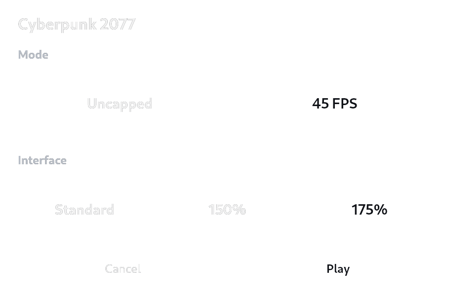
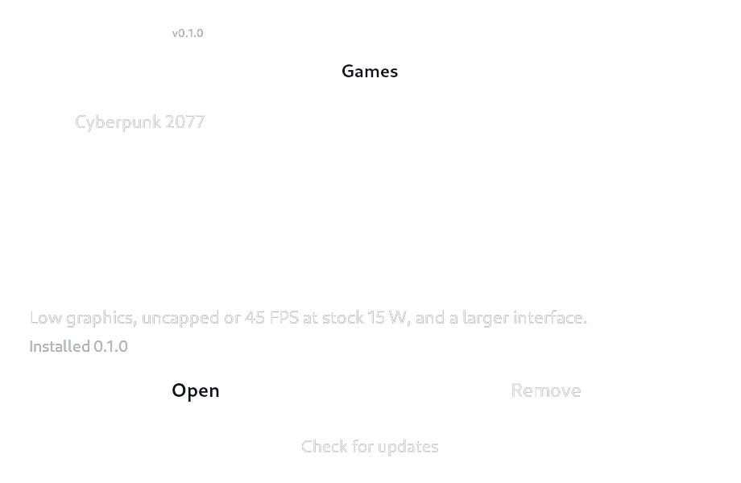

# deckkit

On-demand Steam Deck tools. The first package configures Cyberpunk 2077 graphics,
FPS limiting and interface size.

The launcher opens before the game, then hands control back to Steam. There is no
permanent loader or background updater. Packages are managed from one catalog.
Decky, a system Python installation and a writable SteamOS system partition are
not required.



## Install

1. Install the Steam version of Cyberpunk 2077. Launch it once, then close it.
2. Switch the Deck to Desktop Mode.
3. Download [Install.desktop](https://github.com/basuev/deckkit/releases/latest/download/Install.desktop) and open it.
   If the desktop asks, allow the downloaded launcher to run.
4. In deckkit, choose Cyberpunk 2077 and select `Install and restart Steam`.
   Steam is closed so the installer can register its integration.
5. Select `Return to Gaming Mode`, then launch Cyberpunk from its usual Steam
   library entry. Steam starts again when Gaming Mode opens.

The installer downloads a portable runtime and verifies its pinned SHA-256 hash.
The Cyberpunk package is included in that runtime. No terminal commands are needed.
A deckkit entry is added to the Steam library for later package management.

## Choose a profile

The launch menu remembers the last choices:

- `Uncapped` disables the game's FPS limit. `45 FPS` uses its built-in limiter.
- `Standard` removes our UI scaling archive. `150%` and `175%` enlarge selected
  HUD and menu elements.
- `Play` applies the choices and starts the game. `Cancel` closes the launch.

Both modes use 90 Hz, Steam's FPS limiter disabled and the stock 15 W APU budget.
The 45 FPS option is a cap, not a guarantee of sustained performance. There is no
frame generation. Input-to-screen latency has not been externally measured.

The package is tested on Steam Deck OLED. It applies Low graphics, 1024x768 output
and FSR 2 Performance. LCD Decks, other handhelds and non-Steam installations have
not been verified. Inventory, map, progression and many full-screen menus retain
their original layout. Our personal Steam Input layout and camera preset are not
included in the public package.

## Manage packages



Open deckkit from the Steam library. `Games` contains game-specific packages,
`Device` contains device-wide settings and `Tools` contains independent utilities.
Only categories with available packages are shown. The initial release contains
Cyberpunk 2077 only.

Mark packages to select them across categories. `Install selected` installs them
one after another. If an installation fails, earlier completed packages remain
installed and the catalog reports the failure. Installed selected packages can
also be removed together.

Use `Check for updates` to refresh the catalog. Package updates appear as
`Update`. When a runtime update is available, `Update deckkit` appears in the
footer. Reopen deckkit after updating it. Updates are explicit.

Use `Remove` to restore changes owned by a package. Later edits by the user or
another tool are kept. If deckkit changed Steam display settings, the next
Cyberpunk launch restores those settings in the game's own context, then removes
that temporary launch hook. The catalog stays installed for other packages.

Installation files live under the user's home directory and survive normal
SteamOS image updates. Future Steam client and game updates may require package
or integration updates.

## Command line

The graphical interface and CLI share the same profile operations:

```sh
deckkit status cyberpunk2077
deckkit profile cyberpunk2077 --fps 45 --ui-scale 175
deckkit profile cyberpunk2077 --fps uncapped --ui-scale 100
```

`profile` changes game settings and UI files. Steam display settings are applied
only when Cyberpunk owns the app context during launch. An advanced user can
skip the selector with `launch --no-ui` in the Steam launch wrapper.

## Development

```sh
make dev
make check
make test
```

To review the real UI without a Deck, use a Python installation with Tk:

```sh
make preview
make preview SCREEN=installer
make preview SCREEN=selector
make preview PREVIEW_ARGS='--size 740x520 --error'
```

The preview uses disposable fixtures and simulated Steam transport. It contains
Cyberpunk and 56 mock packages to review scrolling and batch selection. Only
Cyberpunk's fixture uses real package file operations. Other examples simulate installation
in memory. Opening Cyberpunk enters its real launch menu, then returns to the
catalog. Changes are discarded on exit. No real Steam or game files are changed.
`--error` simulates an update-check failure.

On Linux/X11, the existing builder can run the preview if host Tk is unavailable:

```sh
make preview-container
```

This requires the builder image, Docker access, `xauth` and `sed`. It mounts the
source read-only, uses a temporary X11 authority file and disables networking.
Set `DOCKER='sudo -n docker'` if that is how the local Docker service is accessed.
This command does not install software on the Deck.

`make test-ui` runs the full suite, including Tk interaction, under Xvfb in the
Ubuntu 22.04 builder. A headless host without Tk skips those tests in `make test`.
Ruff is a development dependency.

```sh
make release REPOSITORY=owner/repository
```

Release binaries must be built in the provided Ubuntu 22.04 image, rather than
on a newer host. The target SteamOS installation does not need Python, Docker
or Ruff. Building local assets does not publish them.

See the manual [release process](docs/releasing.md) for the published assets.

Read [architecture and product constraints](docs/architecture.md) and
[code style](docs/style.md) before making integration changes. The wordmark's
editable source is [Gridmark JSON](assets/branding/deckkit.gridmark.json).
`scripts/build_branding.py` exports the wide pixel SVG and PNG, using
`rsvg-convert` only during asset generation.

Program code uses the MIT license. Modified Cyberpunk UI resources have their
own [notice](assets/packages/cyberpunk2077/NOTICE.md).

Third-party runtime notices are included in the portable bundle under `LICENSES`.
